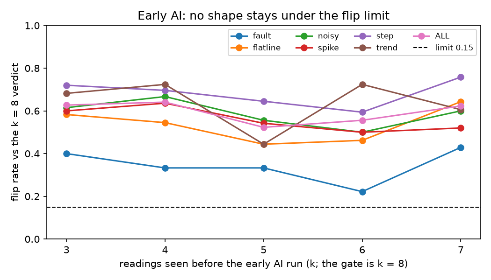

# Early AI on strong warnings: can the reasoner run before the 8-reading gate? (v5, 2026-11-27)

**Answer: no. No warning shape clears at any k from 3 to 7. Early AI stays off on the board (`ai_early_k` unset, `ai_early_shapes` empty).**

## Question

The gate waits for 4 abnormal of 8 readings (40–55 min of sensor time) before the AI runs. That wait is most of the
real-world latency. Could the AI run after k < 8 readings on strong warnings and show a provisional verdict, without
losing accuracy?

## Method

- **Data:** 440 event groups, 6 shapes (spike, step, trend, flatline, noisy, fault), injected into real held-out campus
  windows. Each group is run at k = 3, 4, 5, 6, 7 and 8 readings: 2,640 rows, 1,102 AI runs.
- **Models = board:** reasoner `rsn_v3_4b_v5` (Q4_0) and agents `agt3_s0450` (Q4_0), md5 checked against the board;
  board profile lines (`reasoner_prompt=v4`, `reasoner_think=adaptive`, `agents=agt_v3`, `agent_tools=1`).
- **Backend = app:** the real Go backend (`eas_test.go` drives the engine and reasoner), served by llama.cpp CUDA on the
  laptop through an htpd-compatible shim (`htpd_shim_v5.py`). Greedy decoding.
- **Clear rule (fixed before the run):** a shape clears at k when, for k and every larger k, with ≥ 8 pairs: the verdict
  flips vs the k = 8 verdict in ≤ 15 % of pairs, severity and label accuracy drop ≤ 5 pp, and no significant
  win/loss imbalance.

## Results

| shape | k=3 pairs | k=3 flip | k=3 Δ severity acc (pp) | flip k4 / k5 / k6 / k7 | clears at |
|---|---|---|---|---|---|
| spike | 20 | 0.60 | -15.0 | 0.64 / 0.54 / 0.50 / 0.52 | none |
| step | 25 | 0.72 | -4.0 | 0.70 / 0.65 / 0.59 / 0.76 | none |
| trend | 22 | 0.68 | +9.1 | 0.72 / 0.44 / 0.72 / 0.61 | none |
| flatline | 12 | 0.58 | -33.3 | 0.55 / 0.44 / 0.46 / 0.64 | none |
| noisy | 13 | 0.62 | -23.1 | 0.67 / 0.56 / 0.50 / 0.60 | none |
| fault | 10 | 0.40 | -30.0 | 0.33 / 0.33 / 0.22 / 0.43 | none |
| **all** | 102 | 0.63 | -11.8 | 0.64 / 0.52 / 0.56 / 0.62 | **none** |

Full per-k numbers (accuracy, wins/losses, label flips, checklist Jaccard): `results/early_ai_v5.json`.

## Findings

1. **Verdicts are not stable before the gate.** Flip rates are 0.22–0.76 against a 0.15 limit; even one reading before
   the gate (k = 7) the large shapes flip 52–76 %.
2. **Accuracy drops early** for 5 of 6 shapes; flatline, noisy and fault lose 23–33 pp severity accuracy at k = 3.
3. **False starts:** early runs fire on events the full gate never reports (fault 11 of 25, noisy 7 of 21, spike 8 of 42).
4. **Side finding:** 19 % of AI runs (210 of 1,102) had the reasoner report rejected by the validator and replaced by the
   rules report; top reason a warning checklist with no inspect/review action (60).
5. **Not measured:** the run-to-run noise floor of the host servers (k = 8 self-repeat stopped before it ran). It could
   explain part of the flip rate, but not the accuracy losses.

## Implication for the paper

Latency on this system is dominated by the sensor-time gate, not compute; cutting the gate with an early reasoner run
trades away exactly the stability and accuracy the escalation result depends on. Compute-side cuts (agents during the
gate wait, shadow-tested in the app as `agent_prefetch=shadow`) are the safe direction. A future early path needs a
stability mechanism first (e.g. show a provisional verdict only when the k and k + 1 runs agree, or show the rules report
early), then this study rerun (~3.7 h laptop GPU).

## What the app does instead (owner decision 2026-11-27)

The early verdict is shown, but as an **"Early look"** badge with the time to the full reading, not as the alert. The
full reading at the gate is made independently: the early verdict, severity and agent answers are not inputs to it
(not in the reasoner's re-check list, not in retrieval, severity reset). An early look the gate never confirms closes as
"not confirmed". Board setting: `ai_early_k=3` (a single spike never calls the AI), all six shapes plus `limit` (a value past its
limit with no trend shape, found missing in the first board check).

## Files

- `code/early_ai/`: `eas_test.go` (app-faithful driver), `htpd_shim_v5.py`, `run_v5.sh`, `run_v5_repeat.sh`,
  `analyze.py`, `plot_flip.py`.
- `results/early_ai_v5.json`: aggregate results.
- Raw rows (real sensor windows and prompts) stay on the laptop in `proofs/2026-11-12_early_ai/raw_v5/`.
